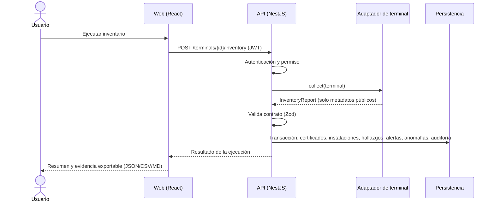
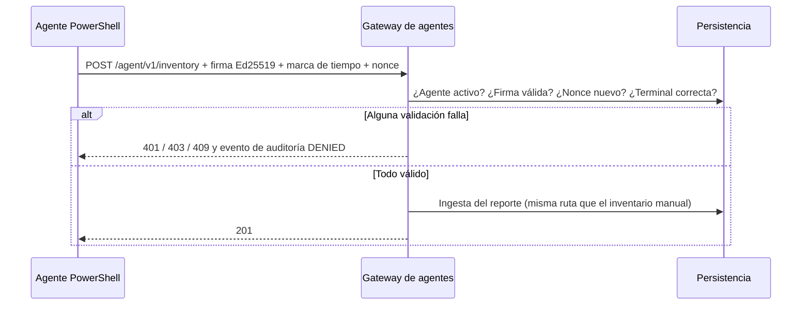

# Arquitectura del sistema

## 1. Principios
Monolito modular sin microservicios innecesarios; reglas de negocio puras en `packages/domain`; integraciones detrás de puertos (adaptadores); seguridad desde el diseño; persistencia intercambiable (SQL Server o archivos JSON) sin cambiar los servicios.

## 2. Capas
| Capa | Implementación |
|---|---|
| Terminal POS | Script `powershell/inventory/Get-CertificateInventory.ps1` (real, solo lectura) y terminales virtuales |
| Integración | `SimulatedPosAdapter`, `SimulatedCertificateIssuer`, `SimulatedDeploymentExecutor`, `BasicCertificateValidator`, `InAppNotificationProvider`, `SimulatedMshAdapter` (activos); `WindowsCertificateStoreAdapter` (**deshabilitado**) |
| Servicios de negocio | Módulos NestJS: autenticación, auditoría, inventario, alertas, seguridad/anomalías, responsables, renovaciones, instalaciones, monitoreo, investigación, simulador, administración |
| Persistencia | `PrismaService` (SQL Server) o `MockPrismaClient` (JSON), elegidos por `MOCK_DATABASE` |
| Presentación | React: 15 pantallas en español |

## 3. Flujo de información de extremo a extremo

## 4. Flujo de inventario por agente

## 5. Decisiones arquitectónicas
- [ADR-001](adr/001-monorepo-y-lenguaje.md) Monorepositorio, idioma y convenciones.
- [ADR-002](adr/002-auditoria-encadenada.md) Auditoría encadenada.
- [ADR-003](adr/003-identidad-certificado-vs-instalacion.md) Certificado frente a instalación.
- [ADR-004](adr/004-prisma-6-sql-server.md) Prisma 6 y SQL Server.
- [ADR-005](adr/005-base-de-datos-simulada.md) Base de datos simulada en JSON.
- [ADR-006](adr/006-aprobacion-por-huella-de-parametros.md) Aprobación vinculada a la huella de parámetros.
