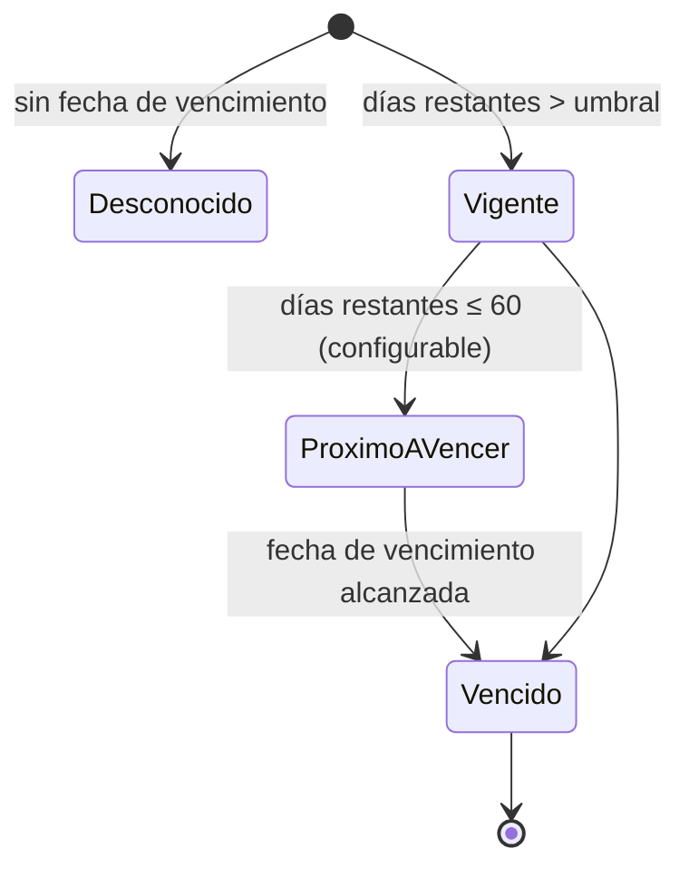

# Ciclo de vida de los certificados

## Vigencia (RF04)

La vigencia se calcula con `classifyValidity` (`packages/domain`). Es independiente de la revocación y del estado de la instalación (`PRESENT` o `MISSING`). El reloj se inyecta (`FIXED_NOW`) para escenarios reproducibles.

## Alertas (RF05)
Umbrales por defecto: 60, 30, 15 y 7 días; vencido equivale a umbral 0. Prioridades: baja (60), media (30), alta (15), crítica (≤ 7 o vencido). Se crea **una alerta por certificado, terminal y umbral** (deduplicación). Al cruzar un umbral menor, las alertas abiertas de umbrales mayores pasan a `SUPERSEDED` (escalamiento). El responsable efectivo sale de la precedencia certificado > política > emisor.

## Renovación
La renovación de un certificado sigue el flujo de [flujo-renovacion.md](flujo-renovacion.md); `Certificate.renewalStatus` refleja el estado de la solicitud activa.

## Instalaciones
Un mismo certificado puede estar instalado en varias terminales. Si un inventario completo no lo encuentra, la instalación pasa a `MISSING`; si el almacén no pudo leerse (inventario parcial) no se marca como ausente.
