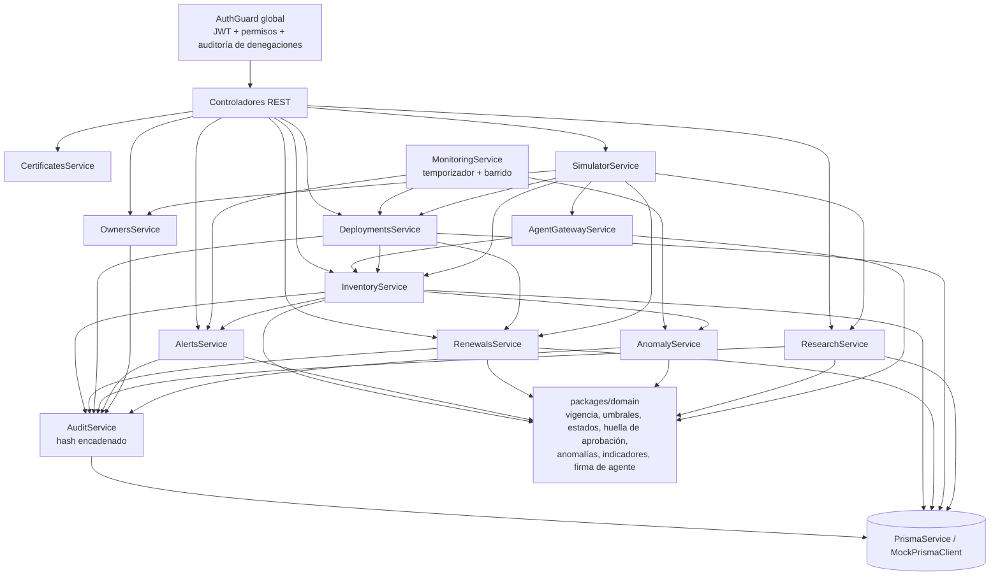

# Componentes (C4 nivel 3) — API

Módulos NestJS: `AuthModule`, `AuditModule`, `PrismaModule` (globales), `InventoryModule`, `AlertsModule`, `SecurityModule`, `RenewalsModule`, `ResearchModule` y `OperationsModule` (administración, responsables, monitoreo y simulador).
