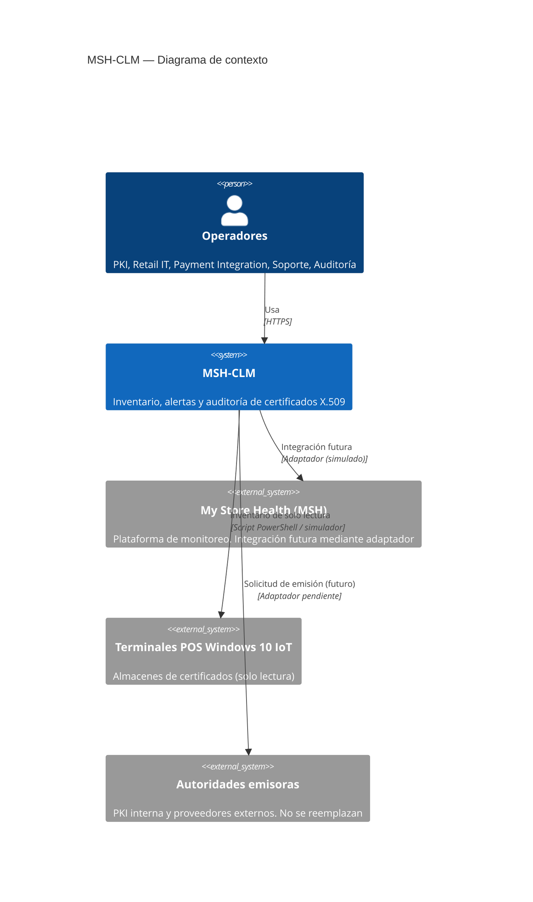

# Contexto (C4 nivel 1)

Estado: en esta versión solo el simulador y el script local están operativos; MSH y las autoridades emisoras son interfaces pendientes. No se asumen endpoints ni contratos de MSH.
