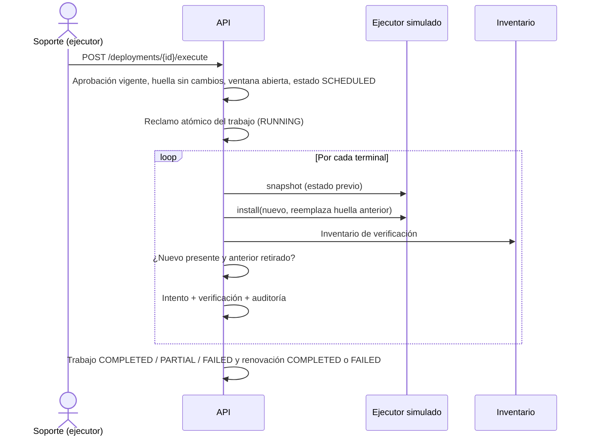

# Flujo de instalación, verificación y reversión (RF08, RF09)

## Modos
| Modo | Estado |
|---|---|
| Simulación | Operativo. Modifica solo terminales virtuales (certificados públicos en PEM). |
| Laboratorio autorizado | **Deshabilitado.** Se rechaza con `LAB_MODE_DISABLED`. Requeriría autorización, terminal permitida, identidad validada, aprobación, ventana válida, script firmado y recuperación verificable. |

La instalación nunca recibe ni almacena claves privadas: en laboratorio real la clave se aprovisionaría por un mecanismo externo autorizado.

## Instalación

## Controles
- **Idempotencia:** la programación usa `idempotencyKey` único; repetirla devuelve el mismo trabajo.
- **Ejecución duplicada:** un trabajo que no está `SCHEDULED` responde `JOB_ALREADY_EXECUTED`; dos ejecuciones simultáneas producen un único intento.
- **Ventana de mantenimiento:** se valida al programar y al ejecutar.
- **Verificación real:** tras instalar se vuelve a inventariar la terminal; no se declara éxito por el solo hecho de instalar.
- **Fallas simuladas** (solo con `simulator:manage`): `INSTALL_FAILURE`, `VERIFICATION_FAILURE`, `ROLLBACK_FAILURE` (verificación fallida y reversión fallida).

## Reversión (operación independiente)
`POST /deployments/{id}/rollback` restaura el estado previo guardado para el destino, vuelve a inventariar y registra una `RollbackOperation` con motivo, estado previo, resultado y evidencia. Si la recuperación falla, el destino queda `ROLLBACK_FAILED` y la renovación **no** se marca como revertida. No se asume que reinstalar un certificado público recupere una clave privada.

## Conciliación
`POST /deployments/reconcile` (y el barrido de monitoreo) marca como fallidas las instalaciones `RUNNING` con más de 15 minutos; nunca como exitosas.
