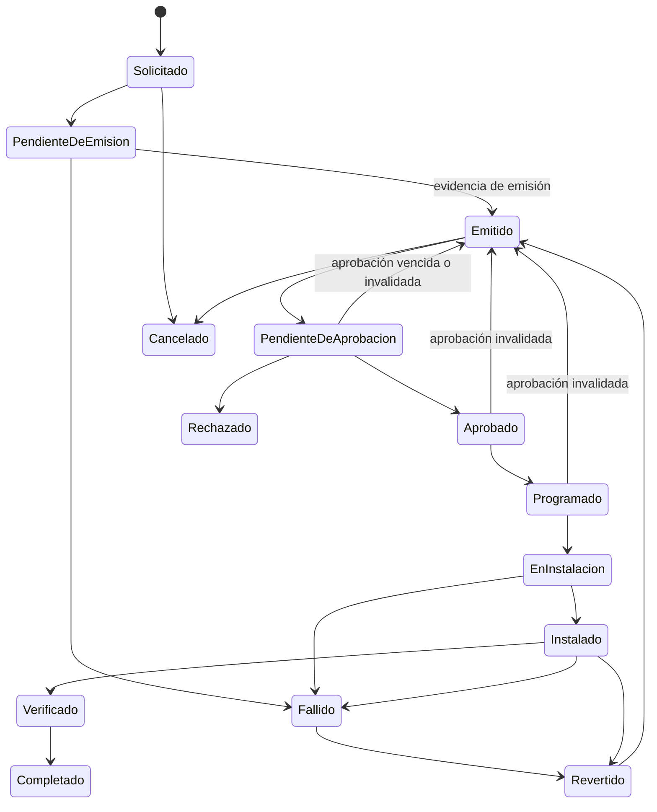

# Flujo de renovación y aprobación (RF06, RF07)

## Reglas
1. **Transiciones válidas únicamente** (`canTransition`); cualquier otra devuelve `INVALID_TRANSITION` (409).
2. **Sin evidencia no hay emisión:** el emisor simulado devuelve el certificado y una evidencia (identificador, fecha, serie, huella, emisor). Sin ella el estado `ISSUED` no se registra. El certificado emitido se valida contra la política (vigencia, `clientAuth`, tamaño y firma).
3. **Una renovación activa por certificado.**
4. **Aprobación vinculada a una huella** SHA-256 de: certificado, certificado nuevo, terminales, operación, ventana de mantenimiento y responsable efectivo ([ADR-006](adr/006-aprobacion-por-huella-de-parametros.md)). Si cambia cualquiera, la aprobación se **invalida** y la renovación vuelve a `ISSUED`.
5. **Separación de funciones:** solicitante, aprobador y ejecutor son roles distintos. Con la política `approval.separationOfDuties=true` el solicitante no puede aprobar aunque tenga el permiso; el intento se audita como `DENIED`.
6. **Vigencia de la aprobación:** `approval.validityHours` (48 por defecto). Una aprobación vencida no permite decidir ni instalar.
7. Cada transición genera un evento de auditoría con estado anterior y posterior.

## Roles en la configuración por defecto
| Función | Rol de laboratorio |
|---|---|
| Solicita y programa | Retail IT |
| Emite (simulado) | Administrador PKI |
| Aprueba | Responsable del emisor, Payment Integration, PKI |
| Ejecuta y revierte | Soporte de tiendas, Retail IT |
| Inyecta fallas de simulación | Administrador, Administrador PKI |
