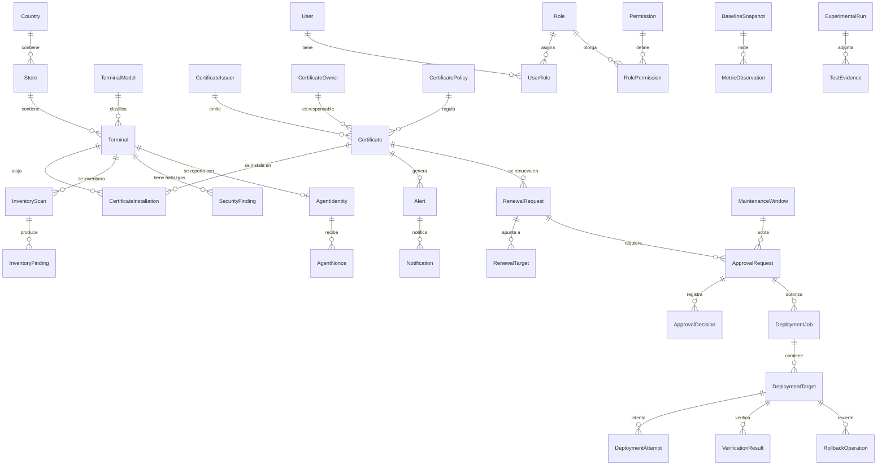

# Modelo de datos

Esquema fuente: [prisma/schema.prisma](../prisma/schema.prisma) (47 entidades). Las fechas se guardan en UTC. Con `MOCK_DATABASE=1` cada entidad es un archivo JSON en `mock-database/`.

## Grupos de entidades
| Grupo | Entidades |
|---|---|
| Inventario | `Country`, `Store`, `TerminalModel`, `Terminal`, `Certificate`, `CertificateInstallation`, `CertificateHistory`, `CertificateIssuer`, `CertificateOwner`, `CertificatePolicy`, `InventoryScan`, `InventoryFinding`, `SimulatedTerminalState`, `SimulatedCertificateSlot` |
| Alertas y seguridad | `Alert`, `Notification`, `SecurityFinding`, `AgentIdentity`, `AgentNonce` |
| Operaciones | `RenewalRequest`, `RenewalTarget`, `ApprovalRequest`, `ApprovalDecision`, `MaintenanceWindow`, `DeploymentJob`, `DeploymentTarget`, `DeploymentAttempt`, `VerificationResult`, `RollbackOperation` |
| Acceso y auditoría | `User`, `Role`, `Permission`, `UserRole`, `RolePermission`, `RefreshToken`, `AuditEvent`, `ConfigurationPolicy` |
| Investigación | `Incident`, `MetricDefinition`, `MetricTarget`, `BaselineSnapshot`, `MetricObservation`, `ResearchSample`, `UsabilitySurvey`, `ExperimentalRun`, `TestEvidence`, `TraceabilityItem` |

## Decisiones
- **Identidad vs. instalación:** `Certificate` (huella SHA-256 única) se separa de `CertificateInstallation`.
- **Sin claves privadas:** solo `hasPrivateKey` (booleano); los PEM almacenados son públicos; `AgentIdentity` guarda solo la clave pública.
- **Cadena de auditoría:** `AuditEvent.previousHash` y `hash` (SHA-256).
- **Estados como cadenas:** SQL Server no admite enumeraciones en Prisma; se validan en el dominio.
- **Referencias a usuarios:** campos como `requestedById` son identificadores sin clave externa; el esquema usa claves externas entre entidades de negocio.

## Entidades de la especificación no creadas
`CertificateOwner` cubre responsables; no se crearon tablas separadas para `TerminalHealth`, `PilotCohort`, `NotificationDelivery`, `ResearchEvidence` ni `UsabilitySurvey` por pregunta: `TerminalHealth` se deriva de `Terminal.status` y los escaneos; la cohorte piloto se representa con `BaselineSnapshot` (tipo `PILOT`); las entregas de notificación con `Notification`; la evidencia de investigación con `TestEvidence`.
